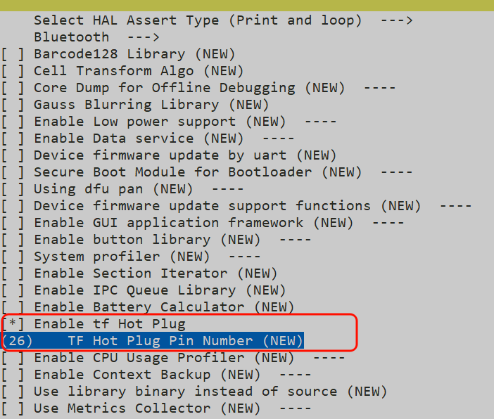
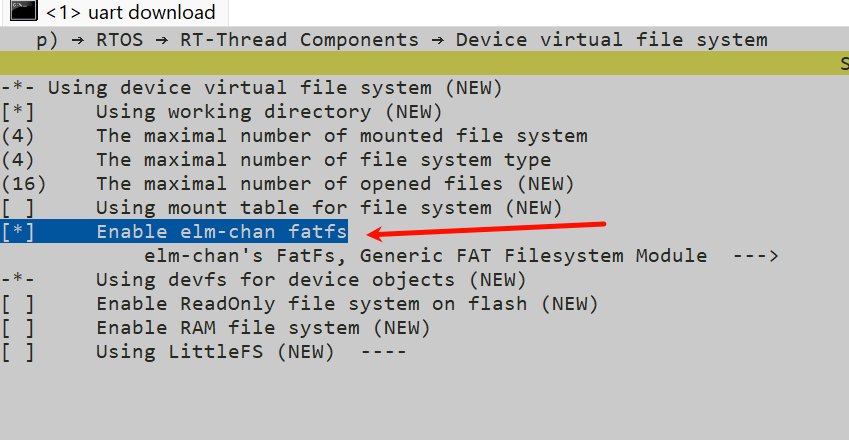
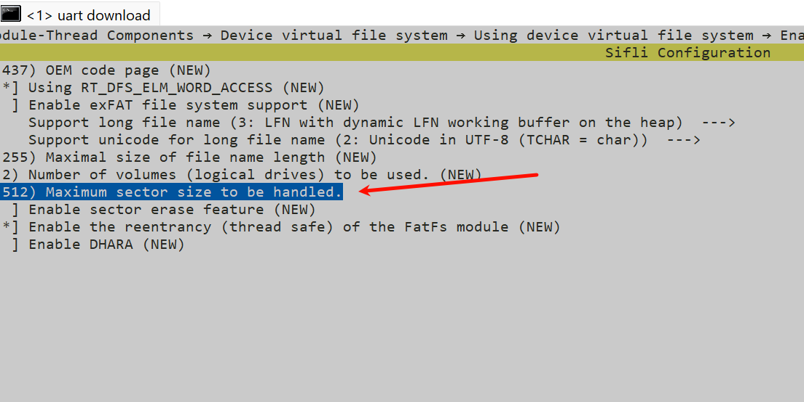
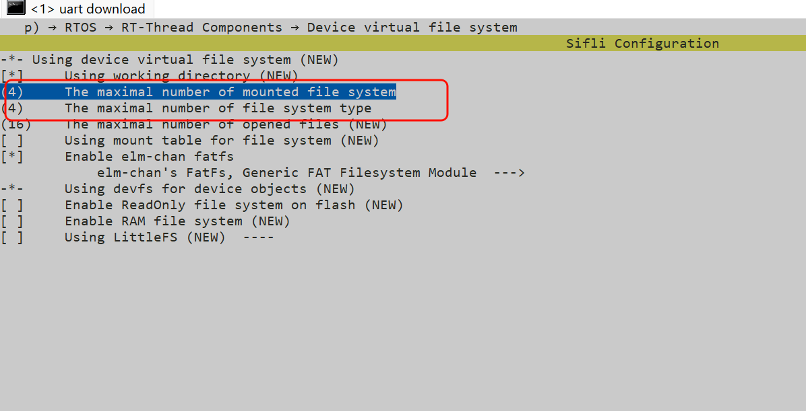
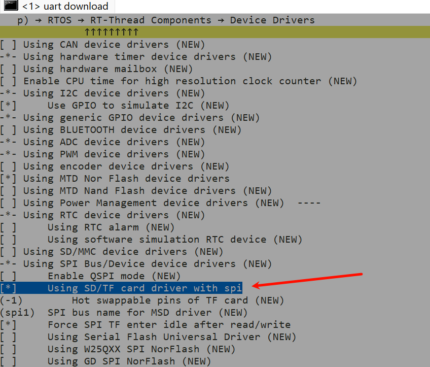
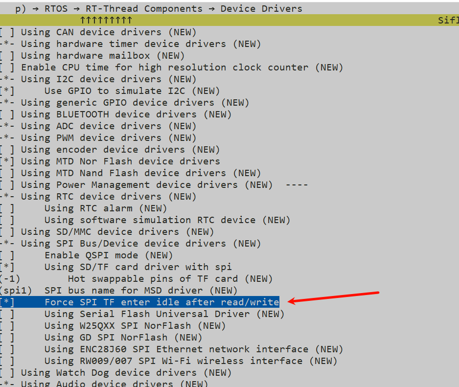

# TF Card Hot-Plug Detection Component

## 📝 组件简介

TF 卡热插拔检测组件是一个用于 SF32LB52x 平台的即插即用模块，提供 TF/SD 卡运行时插拔检测功能。该组件基于 GPIO 中断 + 后台线程机制，能够实时监测 TF 卡的插入和拔出事件，并通过回调函数通知应用层，同时自动完成设备初始化、文件系统挂载/卸载等操作。

### 核心特性

- ✅ **即插即用**：TF 卡插入后自动初始化 SPI-MSD 驱动并挂载文件系统
- ✅ **热拔插支持**：TF 卡拔出后自动卸载文件系统并清理设备资源
- ✅ **开机同步**：支持开机时自动检测已插入的 TF 卡并完成挂载


## ⚙️ 工作原理

### 架构设计

```
┌─────────────────────────────────────────────────────────────┐
│                      Application Layer                       │
│  (Register Callback → Get Notified → Access Files)         │
└───────────────────────┬─────────────────────────────────────┘
                        │ Callback Notification
┌───────────────────────▼─────────────────────────────────────┐
│                 TF Hot-Plug Component                        │
│  ┌────────────┐  ┌──────────────┐  ┌───────────────────┐  │
│  │ GPIO IRQ   │→ │ Detection    │→ │ Mount/Unmount     │  │
│  │ Handler    │  │ Thread       │  │ Handler           │  │
│  └────────────┘  └──────────────┘  └───────────────────┘  │
└───────────────────────┬─────────────────────────────────────┘
                        │ rt_pin_irq / rt_sem / rt_thread
┌───────────────────────▼─────────────────────────────────────┐
│                      RT-Thread RTOS                          │
│  GPIO Driver │ SPI Driver │ DFS │ ELM FAT │ SPI-MSD        │
└──────────────────────────────────────────────────────────────┘
```

### 检测流程

```
用户插入/拔出 TF 卡
         ↓
GPIO 引脚电平变化 (上升沿/下降沿)
         ↓
GPIO 中断触发 → 释放信号量
         ↓
检测线程被唤醒 (或超时轮询)
         ↓
关闭中断 → 读取引脚状态 → 延迟 10ms → 再次读取 (防抖)
         ↓
       状态稳定？
         ↙     ↘
        是       否 → 丢弃此次事件
         ↓
    与上次状态不同？
         ↙     ↘
        是       否 → 忽略
         ↓
┌────────┴────────┐
│ 低电平 (插入)    │ 高电平 (拔出)
↓                  ↓
初始化 SPI-MSD     卸载文件系统
挂载文件系统       注销设备
更新状态为 IN      更新状态为 OUT
触发回调           触发回调
```


## 📚 API 接口说明

### 1. 初始化接口

```c
rt_err_t tf_hot_init(uint8_t pin_num);
```

**功能**：初始化 TF 卡热插拔检测模块

**参数**：
- `pin_num`：TF 卡检测引脚编号（默认 26）

**返回值**：
- `RT_EOK`：初始化成功
- `RT_ERROR`：初始化失败（信号量/线程创建失败）

**说明**：
- 配置 GPIO 为输入模式
- 创建检测信号量和后台线程
- 注册 GPIO 双边沿中断（上升沿+下降沿）
- 读取初始状态（检测开机时是否已插卡）

**示例**：
```c
if (tf_hot_init(TF_HOT_PLUG_PIN) != RT_EOK) {
    rt_kprintf("TF hot-plug init failed!\n");
}
```

---

### 2. 注册回调接口

```c
rt_err_t tf_hot_register_callback(tf_hot_plug_callback_t callback, void *user_data);
```

**功能**：注册 TF 卡状态变化回调函数

**参数**：
- `callback`：回调函数指针（类型：`void (*)(tf_state_t state, void *user_data)`）
- `user_data`：用户自定义数据，会在回调时原样传回

**返回值**：
- `RT_EOK`：注册成功
- `RT_ERROR`：回调函数为 NULL

**说明**：
- 当 TF 卡插入或拔出时，回调函数会在检测线程中被调用
- 回调函数应尽快返回，不要执行耗时操作
- 可以在回调中使用 `rt_kprintf` 输出日志或发送消息队列

**示例**：
```c
static void my_callback(tf_state_t state, void *user_data) {
    if (state == TF_STATE_IN) 
    {
        rt_kprintf("TF card inserted!\n");
    } 
    else 
    {
        rt_kprintf("TF card removed!\n");
    }
}

tf_hot_register_callback(my_callback, RT_NULL);
```

---

### 3. 同步初始状态接口

```c
rt_err_t tf_hot_sync_initial_state(void);
```

**功能**：同步开机时的 TF 卡初始状态

**参数**：无

**返回值**：
- `RT_EOK`：同步成功
- `RT_ERROR`：模块未初始化

**说明**：
- **关键接口**：必须在 `tf_hot_init()` 和 `tf_hot_register_callback()` 之后调用
- 如果开机时 TF 卡已插入，此函数会立即触发插入处理流程（初始化设备+挂载文件系统）
- 如果开机时 TF 卡未插入，此函数不做任何操作

**示例**：
```c
tf_hot_init(26);
tf_hot_register_callback(my_callback, RT_NULL);
tf_hot_sync_initial_state();  // ← 必须调用，确保开机已插卡时能立即可用
```

---

### 4. 状态查询接口

```c
tf_state_t tf_hot_get_state(void);
```

**功能**：获取当前 TF 卡状态

**参数**：无

**返回值**：
- `TF_STATE_IN`：TF 卡已插入
- `TF_STATE_OUT`：TF 卡已拔出

**示例**：
```c
if (tf_hot_get_state() == TF_STATE_IN) {
    rt_kprintf("TF card is present\n");
}
```

---

```c
rt_bool_t tf_hot_is_present(void);
```

**功能**：检查 TF 卡是否在位

**参数**：无

**返回值**：
- `RT_TRUE`：TF 卡已插入
- `RT_FALSE`：TF 卡未插入

**示例**：
```c
if (tf_hot_is_present()) {
    // 可以安全地访问 TF 卡文件
    int fd = open("/test.txt", O_RDONLY);
}
```

---

### 5. 反初始化接口

```c
rt_err_t tf_hot_deinit(void);
```

**功能**：停止热插拔检测并释放资源

**参数**：无

**返回值**：
- `RT_EOK`：反初始化成功

**说明**：
- 关闭 GPIO 中断
- 停止检测线程
- 删除信号量
- 清空回调函数

**示例**：
```c
tf_hot_deinit();
```

---

## 组件使用示例

先在menuconfig中开启需要的宏开关
1. 启用热插拔功能并选择tf卡插拔检测引脚


2. 开启SPI1 并启用TX RX功能


3. 开启文件系统


4. 配置参数



5. 开启spi驱动




### 最小化应用代码（复制即用）

将以下代码复制到你的 `main.c` 文件中，即可实现 TF 卡热插拔功能：

```c
#include "rtthread.h"
#include "bf0_hal.h"
#include "drv_io.h"
#include "stdio.h"
#include "string.h"
#include "tf_hot.h"

/**
 * @brief TF 卡状态变化回调函数
 */
static void tf_hot_plug_callback(tf_state_t state, void *user_data)
{
    if (state == TF_STATE_IN)
    {
        rt_kprintf("[TF Card] 卡已插入，文件系统已挂载\n");
        // TODO: 这里可以添加你的业务逻辑，例如：
        // - 扫描 TF 卡上的文件
        // - 启动 OTA 升级检查
        // - 开始数据记录
    }
    else if (state == TF_STATE_OUT)
    {
        rt_kprintf("[TF Card] 卡已拔出，文件系统已卸载\n");
        // TODO: 这里可以添加你的业务逻辑，例如：
        // - 停止文件操作
        // - 提示用户重新插卡
    }
}

int main(void)
{
    rt_kprintf("Hello, TF Card Hot-Plug Demo!\n");

    /* ============ 初始化 TF 卡热插拔检测 ============ */
    
    // 步骤1：初始化热插拔模块（使用 GPIO26）
    if (tf_hot_init(TF_HOT_PLUG_PIN) == RT_EOK)
    {
        rt_kprintf("[INIT] Hot-plug detection initialized\n");
        
        // 步骤2：注册回调函数
        if (tf_hot_register_callback(tf_hot_plug_callback, RT_NULL) == RT_EOK)
        {
            rt_kprintf("[INIT] Callback registered\n");
            
            // 步骤3：同步初始状态（关键！确保开机已插卡时能立即挂载）
            if (tf_hot_sync_initial_state() == RT_EOK)
            {
                rt_kprintf("[INIT] Initial state synced\n");
            }
        }
        
        // 检查当前状态
        if (tf_hot_is_present())
        {
            rt_kprintf("[INIT] TF card is currently inserted\n");
        }
        else
        {
            rt_kprintf("[INIT] TF card is not inserted, waiting...\n");
        }
    }
    else
    {
        rt_kprintf("[ERROR] Failed to initialize hot-plug detection\n");
    }

    /* ============ 主循环 ============ */
    while (1)
    {
        rt_thread_mdelay(1000);
    }

    return 0;
}
```

**就是这么简单！** 三步即可实现热插拔：
1. `tf_hot_init(26)` - 初始化
2. `tf_hot_register_callback(...)` - 注册回调
3. `tf_hot_sync_initial_state()` - 同步初始状态


